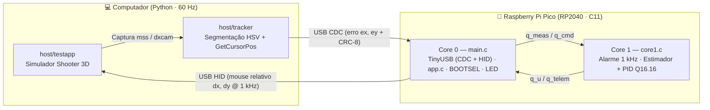
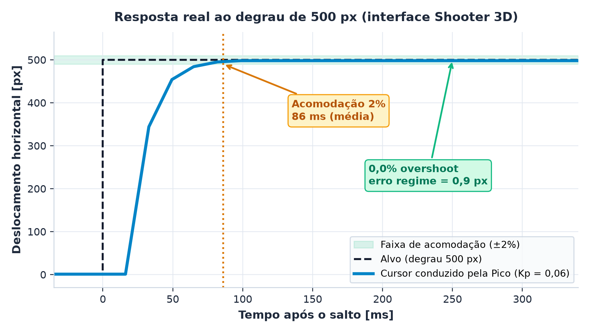
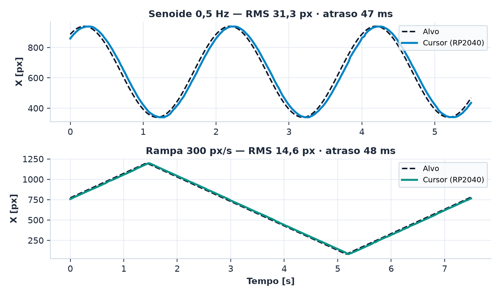

<div align="center">

# 🎯 pico-aim

**Rastreador visual de cursor em malha fechada (1 kHz) com mouse USB HID emulado em RP2040**

*Projeto final de Sistemas Microcontrolados — UTFPR Câmpus Apucarana*  
*Por **Gabriel Paludeto** e **Daniel Elder Kroda***

🇧🇷 **Português** · [🇺🇸 English](README.en.md)

<br/>


<br/>

[Visão Geral](#-visão-geral) · [Arquitetura](#-arquitetura) · [Resultados](#-resultados-em-bancada) · [Como Executar](#-como-executar) · [Documentação](#-documentação) · [Slides](docs/Rastreador%20de%20cursor%20com%20RP2040.pdf)

<br/>


</div>

---

## ✨ Visão Geral

O **pico-aim** fecha uma malha de controle visual usando **apenas uma Raspberry Pi Pico e um cabo micro-USB** — sem nenhum componente eletrônico externo.

No computador, um simulador de estande **Shooter 3D** em Pygame (`host/testapp`) movimenta um robô-alvo com núcleo magenta de alto contraste. O rastreador (`host/tracker`) captura a área da janela a ~60 Hz, encontra o centroide em HSV, lê a posição real do cursor no Windows e envia o erro pela porta serial virtual (**USB CDC**). O **RP2040** executa um controlador PID discreto em ponto fixo (`Q16.16`) a **1 kHz** com estimador multitaxa de latência e atua pelo **mesmo cabo USB** como um **mouse HID relativo**, levando o ponteiro até o alvo.

> [!NOTE]
> **Escopo acadêmico:** todo o rastreamento e a validação experimental foram desenvolvidos exclusivamente para o simulador próprio deste repositório (`host/testapp`), sem integração com jogos ou softwares de terceiros.

### Destaques técnicos

- ⚡ **Dual-Core determinístico:** Core 0 cuida exclusivamente do TinyUSB (CDC + HID), protocolo, botão `BOOTSEL`, LED e watchdog; Core 1 roda apenas a IRQ do controle a `1000,00 µs` (`< 1%` de carga).
- 🔌 **USB Composto nativo:** porta serial virtual CDC-ACM + mouse HID relativo (`bInterval = 1 ms`) no mesmo cabo.
- 🧮 **Ponto fixo `Q16.16` + Estimador de latência:** zero `float` no loop de controle, com histórico circular de 128 comandos (preditor de Smith para planta integradora) eliminando o overshoot da malha multitaxa (60 Hz × 1 kHz).
- 🛡️ **Segurança em hardware:** binário `copy_to_ram`, liberação física pelo botão `BOOTSEL` (toque curto habilita; segurar `1 s` aciona parada de emergência), failsafe de link em `100 ms` e parâmetros persistidos em flash com CRC-8.

---

## 🏗️ Arquitetura



### Pipeline de visão computacional sobre a cena 3D

<p align="center">
  
</p>

---

## 📊 Resultados em Bancada

Ensaio em malha fechada na Raspberry Pi Pico com Windows 11, captura via `mss` a 60 Hz sobre a interface Shooter 3D, aceleração do ponteiro desativada e sensibilidade em 6/11 ($K_p = 0{,}06$, $L = 6\ \text{ms}$, $g = 1{,}25\ \text{px/contagem}$, estimador ativo). Os CSVs originais estão em [`docs/medicoes/`](docs/medicoes/).

| Ensaio (`hw_loop.py`) | Detecção válida | Overshoot | Acomodação (2%) | Regime / RMS | Atraso | `hid_drop` / `errs` |
|---|---|---|---|---|---|---|
| **Degrau 500 px** (`step_trim.csv`) | `100,0%` | **`0,0%`** *(meta < 10%)* | **`86 ms`** (máx. `97 ms`) *(meta < 250 ms)* | **`0,9 px`** *(meta ≤ 2 px)* | — | `0` / `0` |
| **Senoide 0,5 Hz** (`sine_trim.csv`) | `100,0%` | — | — | `31,3 px` (RMS) | `47 ms` | `0` / `0` |
| **Rampa 300 px/s** (`ramp_trim.csv`) | `100,0%` | — | — | `14,6 px` (RMS) | `48 ms` | `0` / `0` |
| **Aleatório suave** (`smooth_trim.csv`) | `100,0%` | — | — | `22,0 px` (RMS) | `45 ms` | `0` / `0` |

<table>
  <tr>
    <td width="50%"></td>
    <td width="50%"></td>
  </tr>
</table>

---

## 🚀 Como Executar

**Pré-requisitos:** Raspberry Pi Pico (RP2040) com cabo micro-USB de dados, Windows 10/11 e Python 3.10+.

### 1. Gravar o firmware na placa

O binário pronto está em [`firmware/prebuilt/cursor_tracker.uf2`](firmware/prebuilt/cursor_tracker.uf2):

1. Segure o botão **BOOTSEL** da Pico ao conectar o cabo USB e solte em seguida.
2. Copie `cursor_tracker.uf2` para a unidade removível `RPI-RP2`.
3. A placa reinicia e enumera uma porta serial (`USB Serial Device (COMx)`) e um mouse HID. O LED GP25 pisca uma vez por segundo indicando operação normal.

### 2. Configurar o ponteiro do Windows

> [!IMPORTANT]
> Em **Configurações → Bluetooth e dispositivos → Mouse → Configurações adicionais do mouse → Opções do ponteiro**:
> - **Desmarque** *"Aumentar precisão do ponteiro"*;
> - Deixe a velocidade do ponteiro na posição central (**6 de 11**).
>
> Sem isso, o Windows aplica aceleração não linear ao mouse e prejudica o controle.

### 3. Instalar dependências Python

```powershell
cd host
python -m venv .venv
.\.venv\Scripts\Activate.ps1
pip install -r requirements.txt
```

### 4. Rodar com a placa conectada

> [!TIP]
> Por segurança, a placa sempre liga **desabilitada**. Dê uma **pressão curta no botão BOOTSEL** para liberar o movimento do cursor (segurar por **1 s** aciona a parada de emergência). Mantenha a janela do Shooter 3D descoberta na tela.

**Modo interativo (Shooter 3D + rastreador em dois terminais — substitua `COM5` pela sua porta):**

```powershell
# Terminal 1 — janela do Shooter 3D
python -m testapp --mode shooter

# Terminal 2 — rastreador e comunicação serial
python -m tracker --port COM5 --mode auto
```

**Ensaio automatizado completo (identificação + 4 trajetórias de referência):**

```powershell
python tests/hw_loop.py COM5
```

---

## ⌨️ Atalhos, Compilação e Testes

<details>
<summary><strong>🎮 Controles na janela do Shooter 3D e no terminal do tracker</strong></summary>

<br/>

**Na janela do `testapp`:**

| Tecla | Ação |
|---|---|
| `1` / `2` / `3` / `4` | Trajetórias de referência: degrau, rampa, senoide e aleatório suave |
| `5` | Modo Shooter 3D interativo (bot com HP e respawn) |
| `Clique` / `Espaço` | Disparo manual |
| `F` | Liga ou desliga o auto-fire ao travar no alvo (`--no-autofire` inicia desligado) |
| `V` | Alterna entre visual 3D e modo 2D clássico (`--classic`) |
| `ESC` | Encerra e grava o CSV |

**No terminal do `tracker`:**

| Tecla | Função |
|---|---|
| `0` / `1` / `2` | Modo `DESLIGADO`, `AUTOMÁTICO` ou `IDENTIFICAÇÃO` |
| `k`, `i`, `d`, `l`, `z`, `g`, `f` | Seleciona $K_p$, $K_i$, $K_d$, latência $L$, zona morta, ganho ou filtro D |
| `+` / `-` | Aumenta ou diminui o parâmetro selecionado |
| `e` | Liga ou desliga o estimador de latência |
| `s` / `o` | Salva parâmetros na flash (em `DESLIGADO`) ou recarrega da flash |
| `q` | Encerra |

</details>

<details>
<summary><strong>🛠️ Compilar o firmware a partir do código-fonte (Pico SDK 2.x)</strong></summary>

<br/>

Requisitos: [Pico SDK](https://github.com/raspberrypi/pico-sdk) 2.x (com submódulo `tinyusb`), CMake ≥ 3.13, Ninja ou Make e `arm-none-eabi-gcc`.

```powershell
set PICO_SDK_PATH=C:\caminho\para\pico-sdk
cd firmware
cmake -S . -B build -G Ninja -DCMAKE_BUILD_TYPE=Release
cmake --build build
```

</details>

<details>
<summary><strong>🧪 Suítes de testes (Python, bancada e C nativo)</strong></summary>

<br/>

```powershell
# Testes do host (protocolo, detecção HSV sobre a cena 3D, trajetórias e análise)
cd host
python tests/test_host.py

# Verificação de bancada na Pico sem mover o cursor (1 ms, failsafe e flash)
python tests/hw_check.py COM5

# 2.165 verificações unitárias em C do firmware compilado no PC (requer gcc)
cd tests
make -f tests.mk test
```

</details>

---

## 📚 Documentação

- 📘 [`docs/guia_codigo.md`](docs/guia_codigo.md) ([English](docs/en/code_guide.md)) — explicação do funcionamento ponta a ponta e papel de cada arquivo do repositório.
- 📐 [`docs/arquitetura.md`](docs/arquitetura.md) ([English](docs/en/architecture.md)) — particionamento dual-core, descritores USB, protocolo CDC, projeto do controlador e medições detalhadas.
- 🎞️ [`docs/Rastreador de cursor com RP2040.pdf`](docs/Rastreador%20de%20cursor%20com%20RP2040.pdf) — slides da apresentação final do projeto.
- 📈 [`docs/medicoes/`](docs/medicoes/) — registros CSV reais coletados em bancada.

## ⚠️ Limitações Conhecidas

- Em alvos contínuos (senoide, rampa e aleatório), permanece um atraso de 45–48 ms originado na captura e detecção de imagem no PC, que o estimador interno não compensa.
- O ganho da planta e a latência $L$ dependem da máquina hospedeira; recomenda-se executar `tests/hw_loop.py` ao mudar de computador ou resolução.
- Medições elétricas com osciloscópio nos pinos de depuração (`GP2` e `GP3`) ainda não foram realizadas.
- O controle utiliza alarme de hardware livre (sem sincronização por USB SOF), e o par `VID:PID 1209:0001` é reservado para testes didáticos em bancada.
