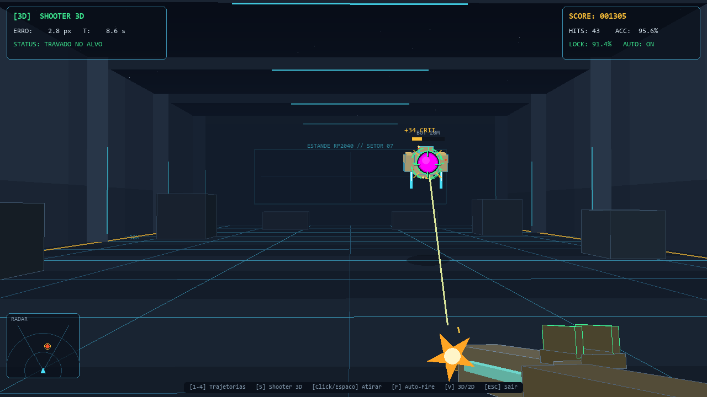
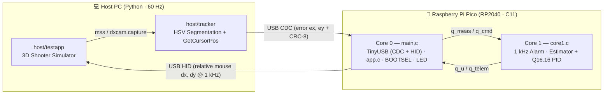
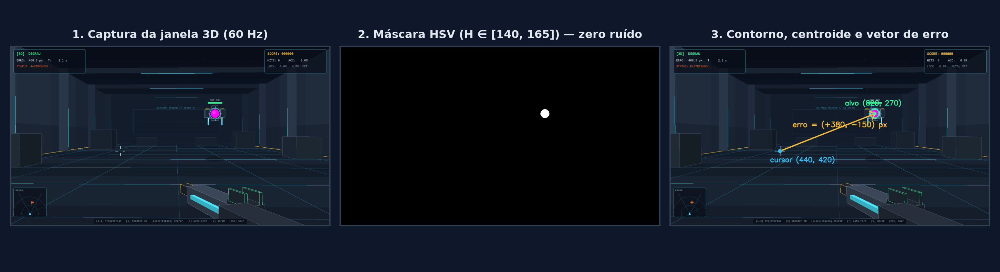

<div align="center">

# 🎯 pico-aim

**Closed-loop visual cursor tracker (1 kHz) with emulated USB HID mouse on RP2040**

*Microcontrolled Systems Final Project — UTFPR, Apucarana Campus (Brazil)*  
*By **Gabriel Paludeto** and **Daniel Elder Kroda***

🇺🇸 **English** · [🇧🇷 Português](README.pt-BR.md)

<br/>


<br/>

[Overview](#-overview) · [Architecture](#-architecture) · [Bench Results](#-bench-results) · [Quick Start](#-quick-start) · [Documentation](#-documentation) · [Slides (PT-BR)](docs/Rastreador%20de%20cursor%20com%20RP2040.pdf)

<br/>



</div>

---

## ✨ Overview

**pico-aim** closes a real-time visual control loop using **only a Raspberry Pi Pico and a micro-USB cable** — no external electronic components required.

On the host PC, a Pygame **3D Shooter** range simulator (`host/testapp`) moves an armored target bot with a high-contrast magenta core. The tracker (`host/tracker`) captures the window client area at ~60 Hz, locates the target centroid in HSV space, reads the OS pointer position on Windows, and streams the position error over virtual serial (**USB CDC**). The **RP2040** runs a discrete fixed-point PID controller (`Q16.16`) at **1 kHz** with a multirate latency estimator and acts over the **same USB cable** as a standard relative **USB HID mouse**, driving the cursor onto the target.

> [!NOTE]
> **Academic scope:** all computer vision, testing, and benchmarking target exclusively the self-contained simulator in this repository (`host/testapp`). There is no integration with third-party games or software.

### Technical Highlights

- ⚡ **Deterministic Dual-Core Design:** Core 0 exclusively handles TinyUSB (CDC + HID), binary framing, the `BOOTSEL` button, LED feedback, and watchdog; Core 1 runs only the 1 kHz hardware-alarm control ISR (`1000.00 µs` period, `< 1%` CPU load).
- 🔌 **Native Composite USB:** CDC-ACM virtual serial port + relative HID mouse (`bInterval = 1 ms`) over a single cable.
- 🧮 **Fixed-Point `Q16.16` + Latency Estimator:** zero `float` math in the control loop, paired with a 128-step circular command history (Smith predictor for an integrating plant) that eliminates overshoot caused by the 60 Hz vs. 1 kHz multirate gap.
- 🛡️ **Hardware Safety:** `copy_to_ram` binary execution, physical enable switch on `BOOTSEL` (short press toggles output; 1 s hold triggers emergency stop), 100 ms link-loss failsafe, and flash parameter persistence protected by CRC-8.

---

## 🏗️ Architecture



### Real-time HSV vision pipeline on the 3D scene

<p align="center">
  
</p>

---

## 📊 Bench Results

Measured on a Raspberry Pi Pico connected to Windows 11, capturing the 3D Shooter interface with `mss` at 60 Hz, pointer acceleration disabled, and Windows pointer speed at 6/11 ($K_p = 0.06$, $L = 6\ \text{ms}$, $g = 1.25\ \text{px/count}$, estimator enabled). Raw CSV logs are stored in [`docs/medicoes/`](docs/medicoes/).

| Test (`hw_loop.py`) | Valid detections | Overshoot | Settling (2%) | Steady-state / RMS | Delay | `hid_drop` / `errs` |
|---|---|---|---|---|---|---|
| **500 px Step** (`step_trim.csv`) | `100.0%` | **`0.0%`** *(target < 10%)* | **`86 ms`** (max `97 ms`) *(target < 250 ms)* | **`0.9 px`** *(target ≤ 2 px)* | — | `0` / `0` |
| **0.5 Hz Sine** (`sine_trim.csv`) | `100.0%` | — | — | `31.3 px` (RMS) | `47 ms` | `0` / `0` |
| **300 px/s Ramp** (`ramp_trim.csv`) | `100.0%` | — | — | `14.6 px` (RMS) | `48 ms` | `0` / `0` |
| **Smooth Random** (`smooth_trim.csv`) | `100.0%` | — | — | `22.0 px` (RMS) | `45 ms` | `0` / `0` |

<table>
  <tr>
    <td width="50%"></td>
    <td width="50%"></td>
  </tr>
</table>

---

## 🚀 Quick Start

**Requirements:** Raspberry Pi Pico (RP2040) + micro-USB data cable, Windows 10/11, and Python 3.10+.

### 1. Flash the firmware

A prebuilt binary is available at [`firmware/prebuilt/cursor_tracker.uf2`](firmware/prebuilt/cursor_tracker.uf2):

1. Hold the **BOOTSEL** button while plugging in the USB cable, then release.
2. Copy `cursor_tracker.uf2` onto the `RPI-RP2` drive.
3. The board reboots and enumerates as a virtual serial port (`USB Serial Device (COMx)`) and an HID-compliant mouse. The onboard LED (`GP25`) pulses once per second when idle.

### 2. Configure Windows pointer settings

> [!IMPORTANT]
> Open **Settings → Bluetooth & devices → Mouse → Additional mouse settings → Pointer Options**:
> - **Uncheck** *"Enhance pointer precision"*;
> - Set pointer speed to the middle notch (**6 of 11**).
>
> Otherwise, Windows applies nonlinear cursor acceleration that degrades closed-loop accuracy.

### 3. Install Python dependencies

```powershell
cd host
python -m venv .venv
.\.venv\Scripts\Activate.ps1
pip install -r requirements.txt
```

### 4. Run with the board connected

> [!TIP]
> For safety, the Pico always boots **disabled**. Give a **short press on BOOTSEL** to enable HID mouse output (holding for **1 s** triggers emergency stop). Keep the 3D Shooter window uncovered on screen.

**Interactive 3D Shooter mode (two terminals — replace `COM5` with your board's port):**

```powershell
# Terminal 1 — 3D Shooter window
python -m testapp --mode shooter

# Terminal 2 — vision tracker & serial link
python -m tracker --port COM5 --mode auto
```

**Automated closed-loop benchmark (plant identification + 4 reference trajectories):**

```powershell
python tests/hw_loop.py COM5
```

---

## ⌨️ Controls, Building & Testing

<details>
<summary><strong>🎮 Keyboard controls (3D Shooter window & tracker terminal)</strong></summary>

<br/>

**In the `testapp` window:**

| Key | Action |
|---|---|
| `1` / `2` / `3` / `4` | Reference trajectories: step, ramp, sine, smooth random |
| `5` | Interactive 3D Shooter mode (bot HP and respawn on elimination) |
| `Click` / `Space` | Manual fire |
| `F` | Toggle auto-fire on target lock (`--no-autofire` starts off) |
| `V` | Switch between 3D view and classic 2D view (`--classic`) |
| `ESC` | Exit and save CSV log |

**In the `tracker` terminal:**

| Key | Action |
|---|---|
| `0` / `1` / `2` | Mode: `OFF`, `AUTO`, or `IDENT` |
| `k`, `i`, `d`, `l`, `z`, `g`, `f` | Select $K_p$, $K_i$, $K_d$, latency $L$, deadband, plant gain, or D filter |
| `+` / `-` | Increase or decrease the selected parameter |
| `e` | Toggle latency estimator |
| `s` / `o` | Save parameters to flash (`OFF` state only) or load from flash |
| `q` | Quit |

</details>

<details>
<summary><strong>🛠️ Building the firmware from source (Pico SDK 2.x)</strong></summary>

<br/>

Requires [Pico SDK](https://github.com/raspberrypi/pico-sdk) 2.x (with the `tinyusb` submodule), CMake ≥ 3.13, Ninja or Make, and `arm-none-eabi-gcc`.

```powershell
set PICO_SDK_PATH=C:\path\to\pico-sdk
cd firmware
cmake -S . -B build -G Ninja -DCMAKE_BUILD_TYPE=Release
cmake --build build
```

</details>

<details>
<summary><strong>🧪 Test suites (Python host, hardware bench, and native C)</strong></summary>

<br/>

```powershell
# Host tests (protocol, HSV detection on 3D frames, trajectories, and log analysis)
cd host
python tests/test_host.py

# Hardware bench check without moving the cursor (1 ms period, failsafe, and flash)
python tests/hw_check.py COM5

# 2,165 native C unit checks on the portable firmware modules (requires gcc)
cd tests
make -f tests.mk test
```

</details>

---

## 📚 Documentation

- 📘 [`docs/en/code_guide.md`](docs/en/code_guide.md) ([Português](docs/guia_codigo.md)) — end-to-end walkthrough and file-by-file map of the codebase.
- 📐 [`docs/en/architecture.md`](docs/en/architecture.md) ([Português](docs/arquitetura.md)) — dual-core split, USB descriptors, CDC protocol, fixed-point controller design, and bench data.
- 🎞️ [`docs/Rastreador de cursor com RP2040.pdf`](docs/Rastreador%20de%20cursor%20com%20RP2040.pdf) — final presentation slide deck (Portuguese).
- 📈 [`docs/medicoes/`](docs/medicoes/) — raw bench measurement CSVs.

## ⚠️ Known Limitations

- On continuous trajectories (sine, ramp, smooth), a 45–48 ms lag remains due to the PC screen-capture and detection pipeline, which the internal actuation estimator cannot predict.
- Effective plant gain (px/count) and latency $L$ depend on the host machine and display scaling; re-run `tests/hw_loop.py` when switching PCs.
- Oscilloscope verification on debug pins `GP2` and `GP3` (control jitter and HID polling interval) is pending.
- The 1 kHz step uses a free-running hardware alarm (without USB SOF sync), and `VID:PID 1209:0001` is a `pid.codes` test ID intended strictly for academic bench use.
